# LiveWallpaper

**English** · [ไทย](README.th.md)

A Windows live wallpaper app built with **Tauri 2 + SvelteKit + TypeScript**.  
It embeds a webview behind the desktop icons and can play local videos with GPU effects, seamless looping, power-saving rules, and a Thai/English settings UI.

---

## Screenshots

### Desktop wallpaper

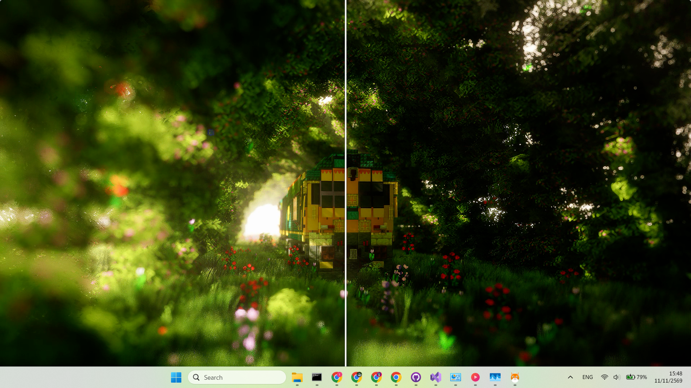

### Settings — Wallpaper

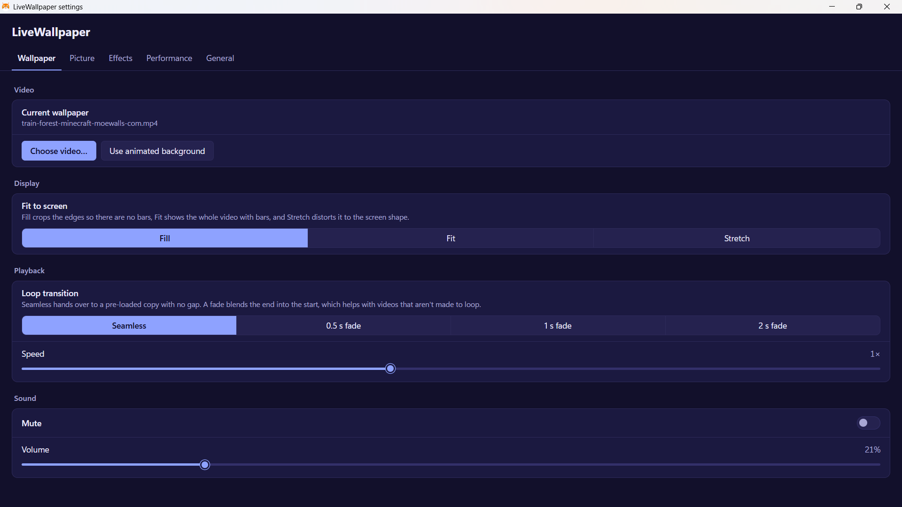

Choose a local video, fit mode (Fill / Fit / Stretch), seamless or fade loop, playback speed, mute and volume.

### Settings — Picture

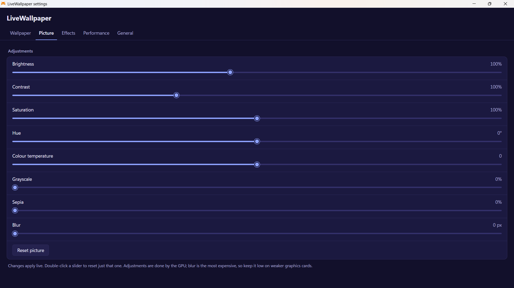

Brightness, contrast, saturation, hue, colour temperature, grayscale, sepia, blur — all applied live on the GPU.

### Settings — Effects

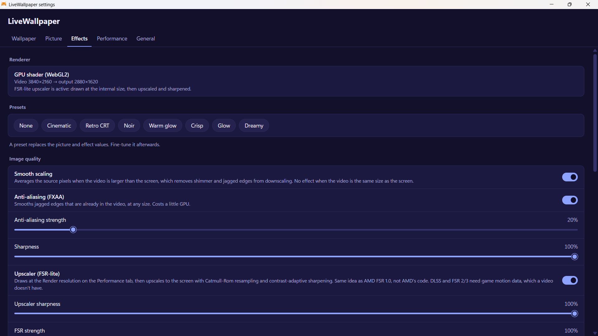

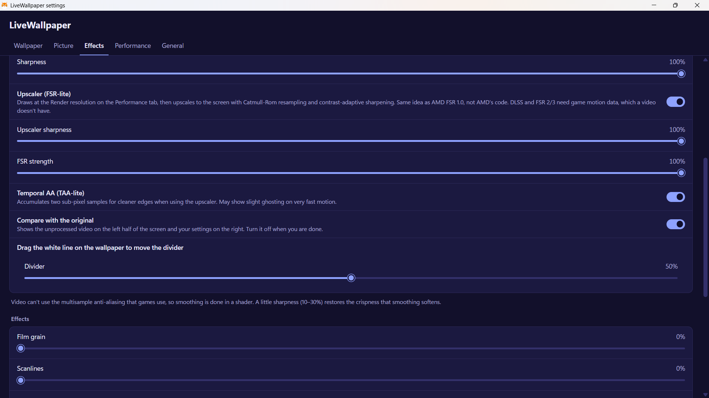

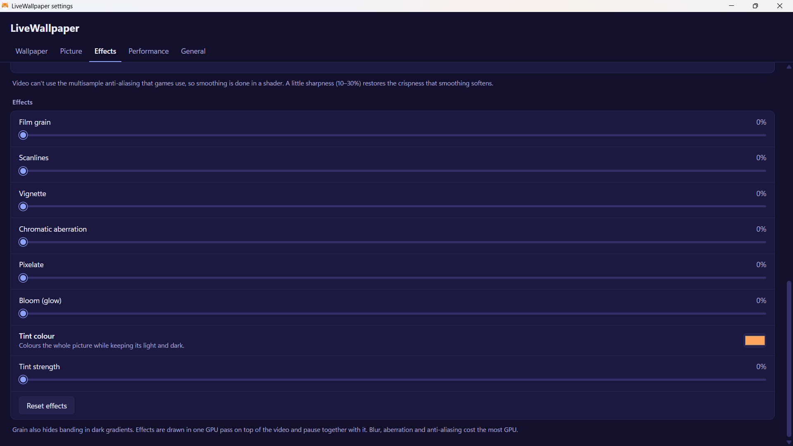

GPU shader status, presets (Cinematic, Retro CRT, Noir, Warm glow, Crisp, Glow, Dreamy), smooth scaling, FXAA, sharpness, FSR-lite upscaler, TAA-lite, compare view, film grain, scanlines, vignette, chromatic aberration, pixelate, bloom, tint.

### Settings — Performance

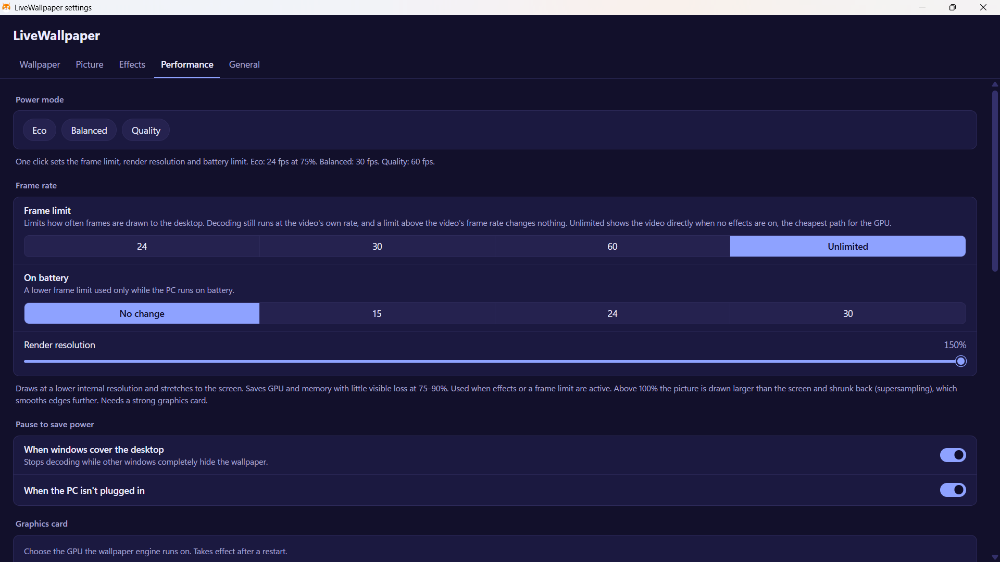

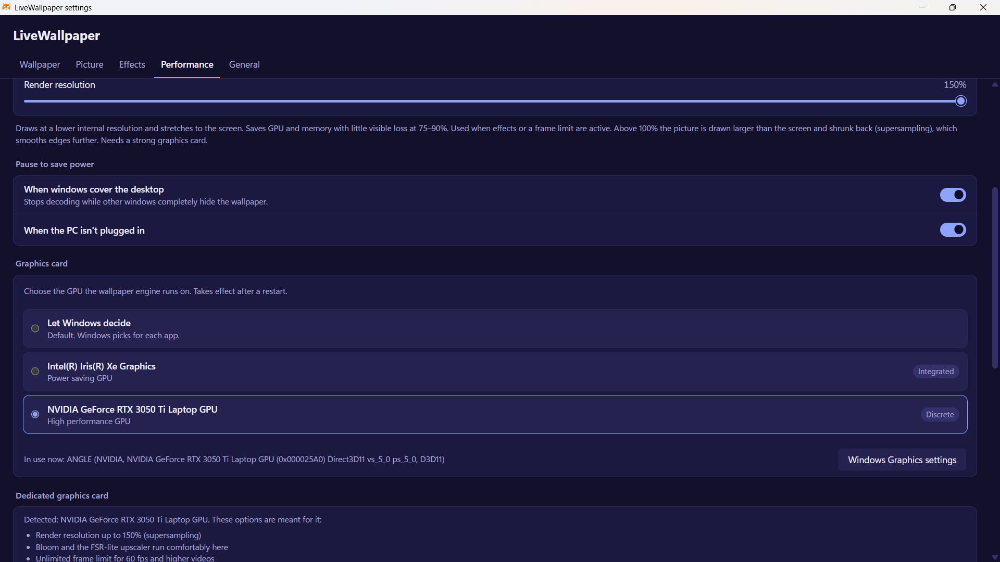

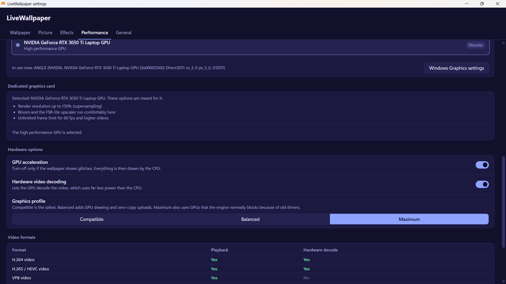

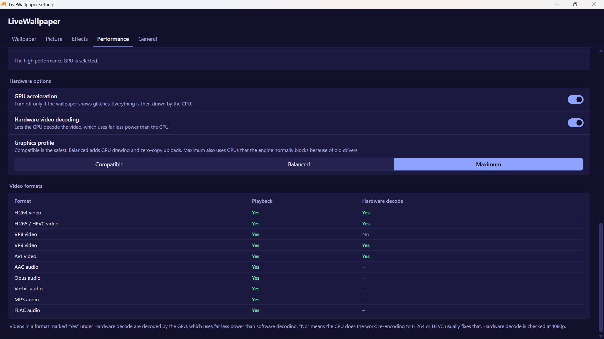

Power mode, frame limit, battery FPS, render resolution (up to 150% on discrete GPUs), pause rules, GPU picker, hardware acceleration, codec table.

### Settings — General

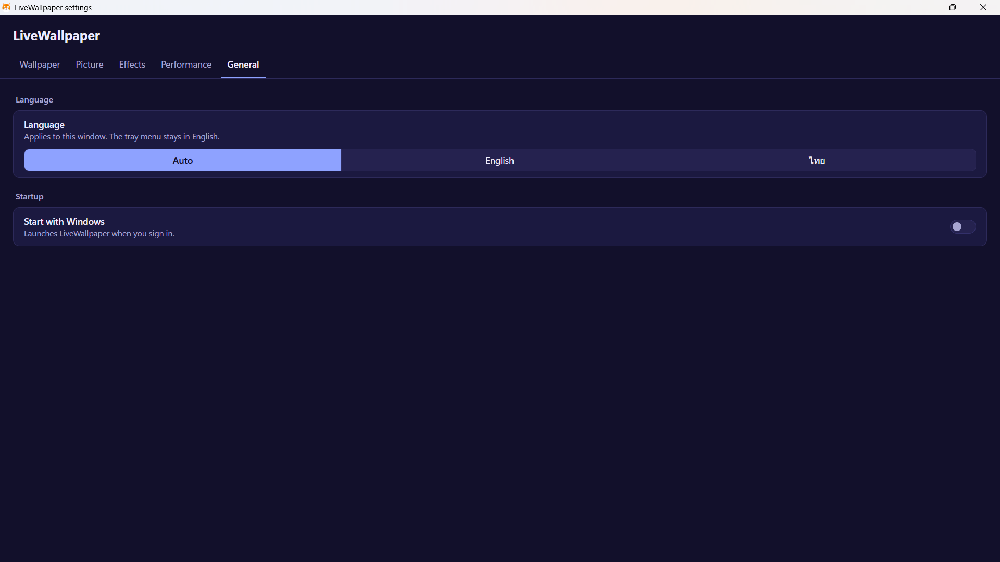

Language (Auto / English / ไทย) and Start with Windows.

---

## Features

### Wallpaper engine

- Places the window between the wallpaper and desktop icons (WorkerW / Progman, including Windows 11 24H2+)
- Local video playback via WebView2 asset protocol
- Seamless loop with dual-video hand-off (no seek gap) or optional crossfade
- Animated flow-field fallback when no video is selected
- System tray: Settings, Pause/Resume, Quit

### Picture & Effects

- Brightness, contrast, saturation, hue, colour temperature, grayscale, sepia, blur
- GPU shader (WebGL2): smooth scaling, FXAA, adaptive sharpening, FSR-lite upscaler, TAA-lite, bloom, chromatic aberration, pixelate, film grain, scanlines, vignette, tint
- Compare view with draggable divider (original vs processed)
- Presets: Cinematic, Retro CRT, Noir, Warm glow, Crisp, Glow, Dreamy

### Performance

- Frame limit: 24 / 30 / 60 / Unlimited
- Lower frame limit on battery
- Render resolution 50–150% (supersampling on discrete GPUs)
- Power modes: Eco / Balanced / Quality
- Pause when desktop is fully covered or on battery
- GPU picker (integrated / discrete) + Windows Graphics settings shortcut
- Hardware options: GPU acceleration, hardware video decode, graphics profile
- Codec support table (playback + hardware decode)

### General

- Language: Auto / English / ไทย (settings UI)
- Start with Windows (HKCU Run key)
- Settings saved to `%APPDATA%\<app>\settings.json`

---

## Requirements

| Item | Detail |
|------|--------|
| **OS** | Windows 10 (1809+) or Windows 11 |
| **Runtime** | [Microsoft Edge WebView2 Runtime](https://developer.microsoft.com/microsoft-edge/webview2/) (usually pre-installed) |
| **Disk** | ~50 MB for the app + space for your video files |
| **GPU** | Any; discrete GPU recommended for high render scale, bloom and FSR-lite |
| **Codecs** | H.264/AAC in MP4 and VP9/Opus in WebM are the safest choices |

---

## Installation

### Option A — Installer (recommended)

1. Download the latest release (`.exe` NSIS installer or `.msi`).
2. Run the installer and follow the prompts.
3. After install, launch **LiveWallpaper** from the Start menu or desktop shortcut.
4. A tray icon appears. Right-click → **Settings…** to choose a video.

> **Note:** “Start with Windows” only works with an installed (release) build, not a debug build.

### Option B — Build from source

#### Prerequisites

```text
- Node.js 18+ (LTS recommended)
- Rust (stable) — https://rustup.rs
- Windows SDK / Visual Studio Build Tools (for Tauri)
- WebView2 Runtime
```

#### Steps

```bash
# 1. Clone the repository
git clone https://github.com/tew080/LiveWallpaper.git
cd livewallpaper

# 2. Install frontend dependencies
npm install

# 3. (Optional) Preview the Svelte UI in a browser
npm run dev

# 4. Run in development mode (Tauri window + tray)
npm run tauri dev

# 5. Build release installers (NSIS .exe + MSI)
npm run tauri build
```

Output installers are typically under:

```text
src-tauri/target/release/bundle/nsis/
src-tauri/target/release/bundle/msi/
```

The wallpaper attachment logic and system tray only work inside the packaged Tauri app, not in the plain browser preview.

---

## First-run guide

1. Launch the app → tray icon appears.
2. Right-click tray → **Settings…**
3. **Wallpaper** tab → **Choose video…** → pick an `.mp4` / `.webm` / etc.
4. Optionally set Fit mode, loop transition, volume.
5. Open **Effects** or **Picture** to fine-tune look.
6. Open **Performance** to pick your GPU and frame limit.
7. **General** → enable **Start with Windows** if desired.

---

## Project structure

```
src/
  lib/
    FlowField.svelte      # Animated fallback background
    VideoWallpaper.svelte # Dual-video player + canvas/GL path
    gl.ts                 # WebGL2 shader (effects + FSR-lite)
    i18n.svelte.ts        # English / Thai strings
    types.ts              # Shared settings types
  routes/
    wallpaper/            # Full-screen wallpaper page
    settings/             # Tabbed settings window
src-tauri/
  src/
    wallpaper.rs          # Attach to WorkerW / Progman
    monitor.rs            # Covered desktop + battery polling
    settings.rs           # Persist settings, GPU choice, commands
    lib.rs                # Tray, plugins, WebView2 flags
  capabilities/
  tauri.conf.json
```

---

## Settings overview

| Tab | Contents |
|-----|----------|
| **Wallpaper** | Choose video, fit mode (Fill / Fit / Stretch), loop transition, speed, mute / volume |
| **Picture** | Brightness, contrast, saturation, hue, temperature, grayscale, sepia, blur |
| **Effects** | Renderer status, presets, smooth scaling, FXAA, sharpness, FSR-lite, TAA, compare, grain, scanlines, vignette, aberration, pixelate, bloom, tint |
| **Performance** | Power mode, frame limit, battery FPS, render scale, pause rules, GPU picker, hardware options, codec table |
| **General** | Language, Start with Windows |

Settings file location:

```text
%APPDATA%\<app-identifier>\settings.json
```

Attach log (if attachment fails):

```text
%APPDATA%\<app-identifier>\logs\wallpaper-attach.log
```

---

## Tips

- Use **Fill** for no black bars; **Fit** to see the whole video; **Stretch** to force full screen (may distort).
- Keep blur low on weaker GPUs — it is the most expensive filter.
- On a discrete GPU, try render resolution above 100% (supersampling) and the FSR-lite upscaler.
- Hardware decode **Yes** for H.264/HEVC means much lower CPU use. Prefer those formats when possible.
- Compare mode: drag the white line on the desktop to move the divider.
- If the wallpaper sits above icons or is missing, check `wallpaper-attach.log` and restart Explorer or the app.
- Power mode **Eco** = 24 fps @ 75% render; **Balanced** = 30 fps; **Quality** = 60 fps.

---

## Troubleshooting

### Wallpaper does not appear

| Cause | What to try |
|-------|-------------|
| Explorer not ready at login | App retries for up to ~2 minutes. Wait or re-launch. |
| Wrong parent window (Win 11 24H2 layout change) | Check `%APPDATA%\<app>\logs\wallpaper-attach.log`. Restart app after Explorer is fully loaded. |
| Window stuck above icons | Restart the app; it re-applies z-order after show. |
| Another live wallpaper app conflicts | Quit the other app, then restart LiveWallpaper. |

### Video will not play

| Cause | What to try |
|-------|-------------|
| Unsupported codec/container | Prefer **H.264 + AAC in MP4** or **VP9 + Opus in WebM**. Check the codec table in **Performance**. |
| Autoplay blocked with sound | App falls back to muted. Unmute in Settings if allowed. |
| File path not allowed by asset protocol | Re-select the file in Settings so the scope is updated. |
| GPU shader path fails (CORS) | App retries without CORS and falls back to 2D canvas/CSS effects. |

### High CPU or GPU use

| Cause | What to try |
|-------|-------------|
| Unlimited FPS + heavy effects | Set frame limit to 30 or 24; lower render scale; turn off bloom/blur. |
| Software video decode | Re-encode to H.264/HEVC so hardware decode shows **Yes**. |
| Wrong GPU selected | In **Performance**, pick the discrete GPU and restart. |
| Desktop never “covered” | Enable **Pause when windows cover the desktop** so decoding stops when you work. |

### Icons missing or desktop unresponsive

1. Quit LiveWallpaper from the tray.
2. If needed: `Ctrl+Shift+Esc` → restart **Windows Explorer**.
3. Re-launch LiveWallpaper.

### “Start with Windows” does nothing

- Only available in a **release/installed** build (not `tauri dev` / debug).
- Check Task Manager → Startup, or Registry:

```text
HKCU\Software\Microsoft\Windows\CurrentVersion\Run
```

### Settings window does not open

- Tray → **Settings…** builds the window on a background thread to avoid deadlock.
- If it still fails, quit and relaunch the app.

### Black screen or glitches

| Cause | What to try |
|-------|-------------|
| GPU driver blocklist / glitches | **Performance** → Graphics profile → **Compatible**, or turn off GPU acceleration, then restart. |
| Extreme supersampling on weak GPU | Lower render resolution to 75–100%. |
| Compare mode left on | Turn off **Compare with the original** in Effects. |

### Reset all settings

1. Quit the app.
2. Delete:

```text
%APPDATA%\<app-identifier>\settings.json
```

3. Start the app again (defaults are restored).

---

## Supported video formats

Playback depends on WebView2 / system codecs. The **Performance** tab shows a live table.

| Format | Typical support |
|--------|-----------------|
| H.264 (AVC) in MP4 | Yes (hardware on most PCs) |
| H.265 (HEVC) in MP4 | Yes if GPU/OS support is present |
| VP9 in WebM | Often yes |
| AV1 | Depends on GPU |
| VP8, older AVI/WMV | Often limited or software-only |

Recommended: **MP4 (H.264 + AAC)** or **WebM (VP9 + Opus)**

---

## Development notes

- Wallpaper HWND is reparented under `WorkerW` or `Progman` (layout-aware for classic vs Windows 11 24H2+).
- Attachment is retried in a background thread; log written to the app log dir.
- WebView2 flags (autoplay, occlusion, GPU, etc.) are set from `settings.json` **before** the first webview starts — changing hardware options requires a restart.
- Dual `<video>` elements provide seamless loop; standby decoder is released on long clips until near the end.
- Effects path prefers WebGL2; falls back to 2D canvas + CSS filters.

---

## License

This project is licensed under the **GNU General Public License v3.0 or later**.

You may redistribute and/or modify it under the terms of the GPL.  
See the [LICENSE](LICENSE) file for the full text.

```text
LiveWallpaper — Copyright (C) 2026 tew080 and contributors
SPDX-License-Identifier: GPL-3.0-or-later
```

---

## Credits

**Developer:** [tew080](https://github.com/tew080)

**Repository:** [github.com/tew080/LiveWallpaper](https://github.com/tew080/LiveWallpaper)

Built with [Tauri](https://tauri.app/), [SvelteKit](https://kit.svelte.dev/), and Microsoft Edge WebView2.

---

[→ อ่านเป็นภาษาไทย](README.th.md)
