# LiveWallpaper

[English](README.md) · **ไทย**

แอปวอลเปเปอร์แบบเคลื่อนไหวสำหรับ Windows สร้างด้วย **Tauri 2 + SvelteKit + TypeScript**  
ฝังหน้าต่างไว้ด้านหลังไอคอนเดสก์ท็อป รองรับวิดีโอท้องถิ่นพร้อมเอฟเฟกต์ GPU, ลูปไร้รอยต่อ, กฎประหยัดพลังงาน และหน้าตั้งค่าภาษาไทย/อังกฤษ

---

## ภาพหน้าจอ

### วอลเปเปอร์บนเดสก์ท็อป

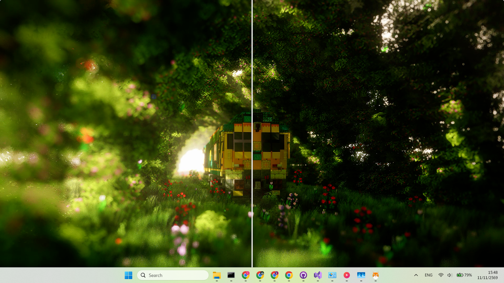

### ตั้งค่า — วอลเปเปอร์

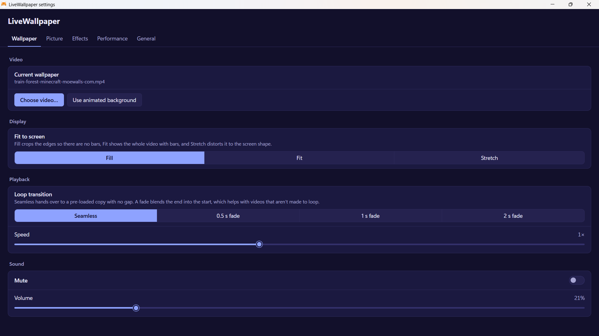

เลือกวิดีโอจากเครื่อง, โหมดพอดีจอ (Fill / Fit / Stretch), ลูปไร้รอยต่อหรือเฟด, ความเร็ว, ปิดเสียงและระดับเสียง

### ตั้งค่า — ภาพ

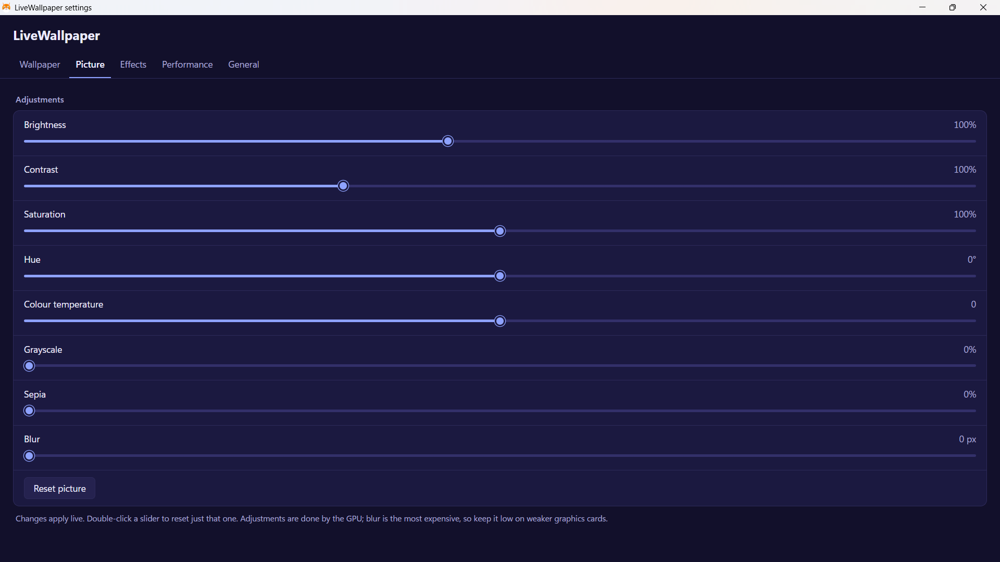

ความสว่าง, คอนทราสต์, ความอิ่มตัว, โทนสี, อุณหภูมิสี, ขาวดำ, ซีเปีย, เบลอ — ปรับสดผ่าน GPU

### ตั้งค่า — เอฟเฟกต์

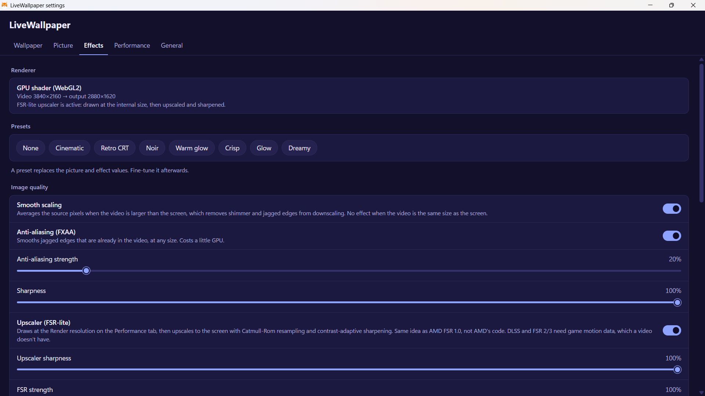

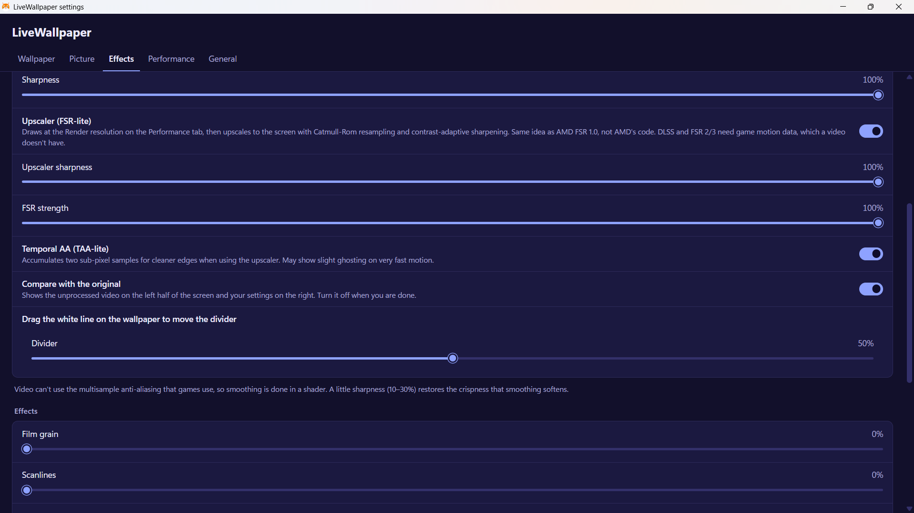

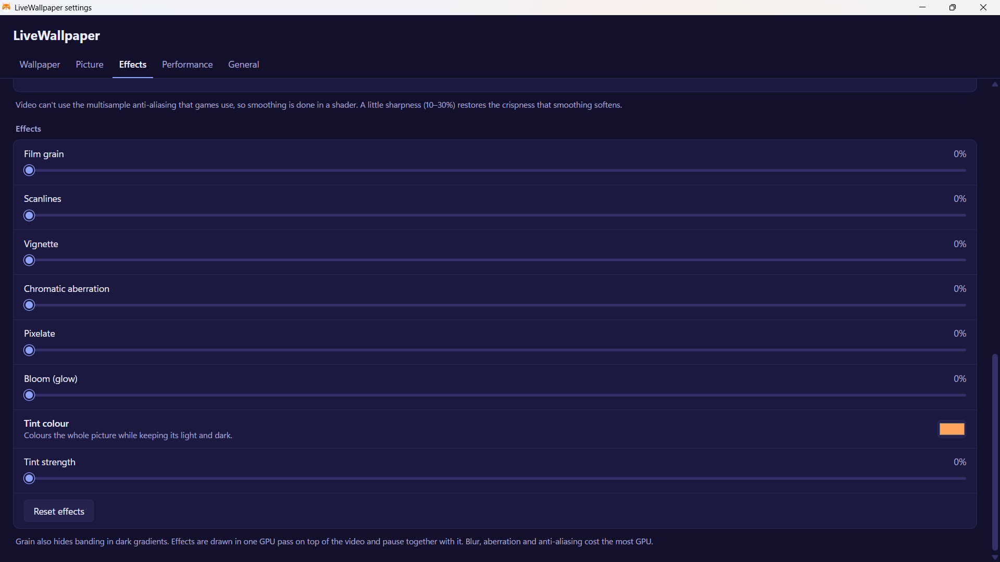

สถานะ shader GPU, พรีเซ็ต (ภาพยนตร์, CRT ย้อนยุค, นัวร์, แสงอบอุ่น, คมชัด, เรืองแสง, ฝันหวาน), smooth scaling, FXAA, ความคม, อัปสเกล FSR-lite, TAA-lite, โหมดเทียบ, เกรนฟิล์ม, scanlines, vignette, aberration, pixelate, bloom, โทนสี

### ตั้งค่า — ประสิทธิภาพ

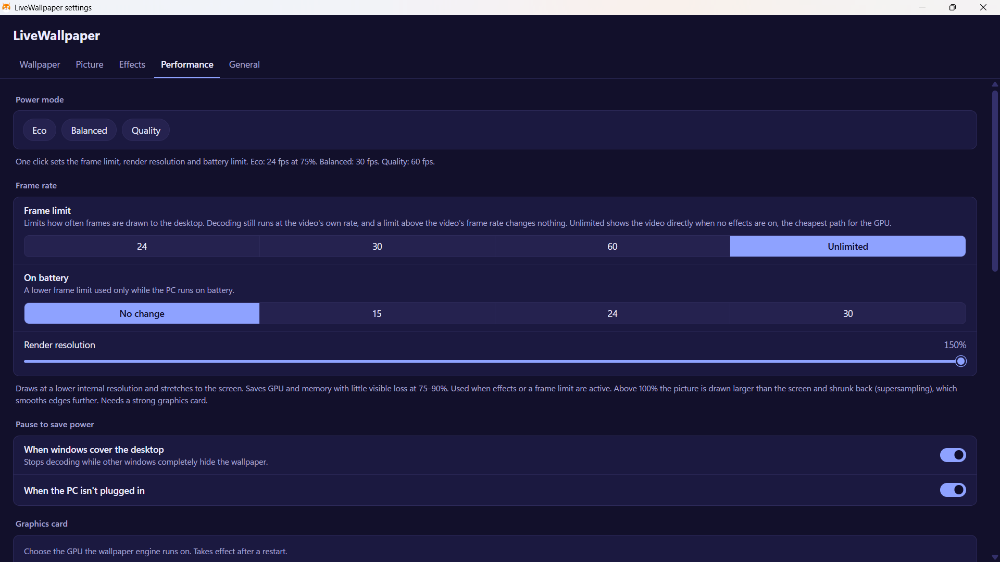

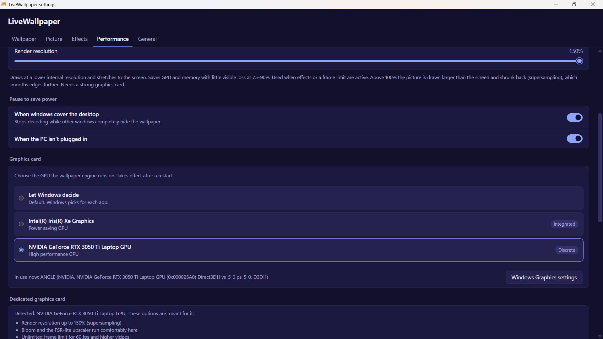

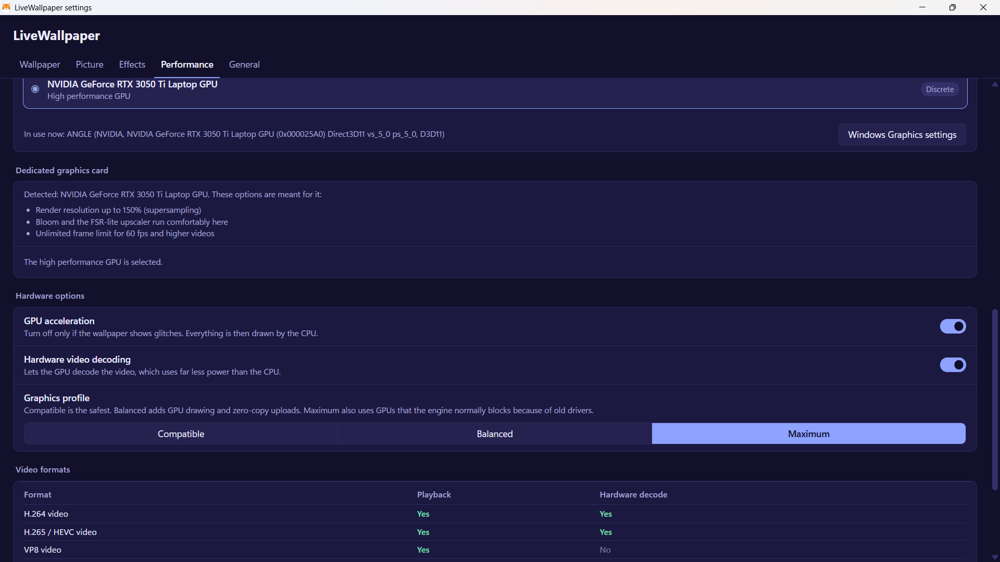

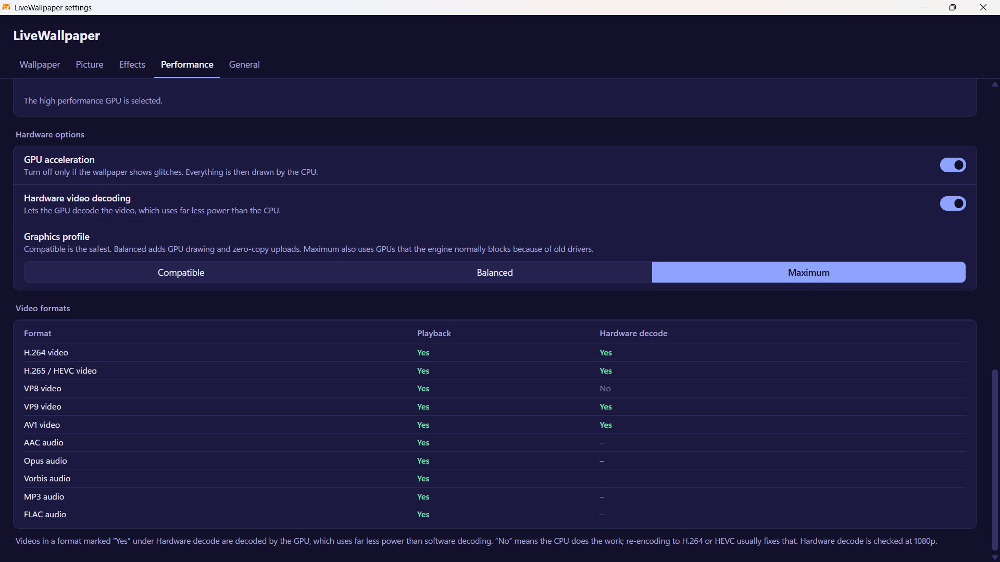

โหมดพลังงาน, จำกัดเฟรม, เฟรมบนแบต, ความละเอียดเรนเดอร์ (สูงสุด 150% บนการ์ดจอแยก), กฎหยุด, เลือก GPU, เร่งฮาร์ดแวร์, ตาราง codec

### ตั้งค่า — ทั่วไป

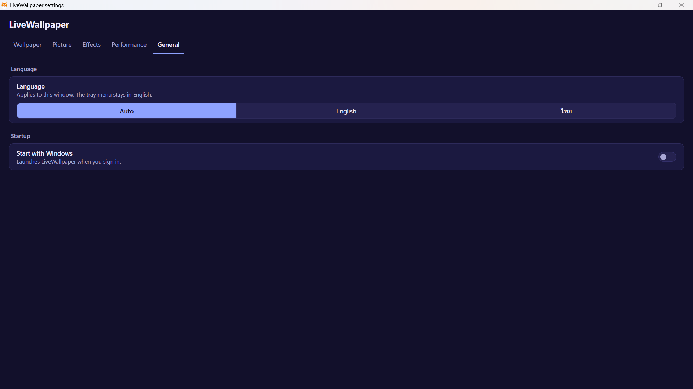

ภาษา (อัตโนมัติ / English / ไทย) และเริ่มพร้อม Windows

---

## คุณสมบัติ

### เครื่องเล่นวอลเปเปอร์

- วางหน้าต่างระหว่างวอลเปเปอร์กับไอคอนเดสก์ท็อป (WorkerW / Progman รวม Windows 11 24H2+)
- เล่นวิดีโอจากไฟล์ในเครื่องผ่าน asset protocol ของ WebView2
- ลูปไร้รอยต่อด้วยวิดีโอ 2 ก๊อปปี้ (ไม่มีช่องว่างตอน seek) หรือเฟดข้ามช่วง
- พื้นหลังแอนิเมชัน flow-field เมื่อยังไม่เลือกวิดีโอ
- ถาดระบบ: ตั้งค่า, หยุด/เล่นต่อ, ออก

### ภาพและเอฟเฟกต์

- ความสว่าง, คอนทราสต์, ความอิ่มตัว, โทนสี, อุณหภูมิสี, ขาวดำ, ซีเปีย, เบลอ
- Shader GPU (WebGL2): ปรับขนาดนุ่ม, FXAA, ความคมแบบ adaptive, อัปสเกล FSR-lite, TAA-lite, bloom, chromatic aberration, pixelate, เกรนฟิล์ม, scanlines, vignette, โทนสี
- โหมดเทียบต้นฉบับกับภาพที่ปรับ ลากเส้นแบ่งได้
- พรีเซ็ต: ภาพยนตร์, CRT ย้อนยุค, นัวร์, แสงอบอุ่น, คมชัด, เรืองแสง, ฝันหวาน

### ประสิทธิภาพ

- จำกัดเฟรม: 24 / 30 / 60 / ไม่จำกัด
- ลดเฟรมอัตโนมัติเมื่อใช้แบตเตอรี่
- ความละเอียดเรนเดอร์ 50–150% (supersampling บนการ์ดจอแยก)
- โหมดพลังงาน: Eco / Balanced / Quality
- หยุดเมื่อหน้าต่างบังเดสก์ท็อปมิด หรือใช้แบตเตอรี่
- เลือก GPU (รวม / แยก) + ทางลัดไป Windows Graphics settings
- ตัวเลือกฮาร์ดแวร์: เร่ง GPU, ถอดรหัสวิดีโอฮาร์ดแวร์, โปรไฟล์กราฟิก
- ตารางรองรับ codec (เล่น + ถอดรหัสฮาร์ดแวร์)

### ทั่วไป

- ภาษา: อัตโนมัติ / English / ไทย (หน้าตั้งค่า)
- เริ่มพร้อม Windows (HKCU Run key)
- บันทึกการตั้งค่าที่ `%APPDATA%\<app>\settings.json`

---

## ความต้องการของระบบ

| รายการ | รายละเอียด |
|--------|------------|
| **ระบบปฏิบัติการ** | Windows 10 (1809+) หรือ Windows 11 |
| **รันไทม์** | [Microsoft Edge WebView2 Runtime](https://developer.microsoft.com/microsoft-edge/webview2/) (มักติดตั้งมาแล้ว) |
| **พื้นที่ดิสก์** | ประมาณ 50 MB สำหรับแอป + พื้นที่สำหรับไฟล์วิดีโอ |
| **GPU** | ใช้ได้ทุกตัว; แนะนำการ์ดจอแยกสำหรับความละเอียดสูง, bloom และ FSR-lite |
| **Codec** | H.264/AAC ใน MP4 และ VP9/Opus ใน WebM ปลอดภัยที่สุด |

---

## การติดตั้ง

### ตัวเลือก ก — ตัวติดตั้ง (แนะนำ)

1. ดาวน์โหลดรีลีสล่าสุด (ตัวติดตั้ง `.exe` แบบ NSIS หรือ `.msi`)
2. รันตัวติดตั้งแล้วทำตามขั้นตอน
3. หลังติดตั้ง เปิด **LiveWallpaper** จากเมนู Start หรือทางลัดบนเดสก์ท็อป
4. จะมีไอคอนถาดระบบ คลิกขวา → **Settings…** เพื่อเลือกวิดีโอ

> **หมายเหตุ:** “เริ่มพร้อม Windows” ใช้ได้เฉพาะกับบิลด์ที่ติดตั้งแล้ว (release) ไม่ใช่บิลด์ debug

### ตัวเลือก ข — สร้างจากซอร์ส

#### สิ่งที่ต้องมีก่อน

```text
- Node.js 18+ (แนะนำ LTS)
- Rust (stable) — https://rustup.rs
- Windows SDK / Visual Studio Build Tools (สำหรับ Tauri)
- WebView2 Runtime
```

#### ขั้นตอน

```bash
# 1. Clone โปรเจกต์
git clone https://github.com/tew080/LiveWallpaper.git
cd livewallpaper

# 2. ติดตั้ง dependency ฝั่ง frontend
npm install

# 3. (ทางเลือก) พรีวิว UI ในเบราว์เซอร์
npm run dev

# 4. รันโหมดพัฒนา (หน้าต่าง Tauri + ถาด)
npm run tauri dev

# 5. สร้างตัวติดตั้ง release (NSIS .exe + MSI)
npm run tauri build
```

ไฟล์ติดตั้งมักอยู่ที่:

```text
src-tauri/target/release/bundle/nsis/
src-tauri/target/release/bundle/msi/
```

ตรรกะการฝังวอลเปเปอร์และถาดระบบทำงานเฉพาะในแอป Tauri ที่แพ็กแล้ว ไม่ใช่ในพรีวิวเบราว์เซอร์ธรรมดา

---

## คู่มือเริ่มใช้งานครั้งแรก

1. เปิดแอป → มีไอคอนถาด
2. คลิกขวาที่ถาด → **Settings…**
3. แท็บ **Wallpaper** → **Choose video…** → เลือกไฟล์ `.mp4` / `.webm` ฯลฯ
4. ตั้งโหมดพอดีจอ, การลูป, ระดับเสียงตามต้องการ
5. แท็บ **Effects** หรือ **Picture** เพื่อปรับภาพ
6. แท็บ **Performance** เพื่อเลือก GPU และจำกัดเฟรม
7. แท็บ **General** → เปิด **Start with Windows** ถ้าต้องการ

---

## โครงสร้างโปรเจกต์

```
src/
  lib/
    FlowField.svelte      # พื้นหลังแอนิเมชันสำรอง
    VideoWallpaper.svelte # เครื่องเล่นวิดีโอคู่ + canvas/GL
    gl.ts                 # WebGL2 shader (เอฟเฟกต์ + FSR-lite)
    i18n.svelte.ts        # สตริงภาษาอังกฤษ / ไทย
    types.ts              # ชนิดข้อมูล settings ที่ใช้ร่วมกัน
  routes/
    wallpaper/            # หน้าวอลเปเปอร์เต็มจอ
    settings/             # หน้าต่างตั้งค่าแบบแท็บ
src-tauri/
  src/
    wallpaper.rs          # ฝังกับ WorkerW / Progman
    monitor.rs            # ตรวจเดสก์ท็อปถูกบัง + แบตเตอรี่
    settings.rs           # บันทึก settings, เลือก GPU, คำสั่ง
    lib.rs                # ถาด, ปลั๊กอิน, แฟล็ก WebView2
  capabilities/
  tauri.conf.json
```

---

## ภาพรวมการตั้งค่า

| แท็บ | เนื้อหา |
|------|---------|
| **Wallpaper** | เลือกวิดีโอ, โหมดพอดีจอ (Fill / Fit / Stretch), การเปลี่ยนลูป, ความเร็ว, ปิดเสียง / ระดับเสียง |
| **Picture** | ความสว่าง, คอนทราสต์, ความอิ่มตัว, โทนสี, อุณหภูมิ, ขาวดำ, ซีเปีย, เบลอ |
| **Effects** | สถานะเรนเดอเรอร์, พรีเซ็ต, smooth scaling, FXAA, ความคม, FSR-lite, TAA, เทียบภาพ, เกรน, scanlines, vignette, aberration, pixelate, bloom, โทนสี |
| **Performance** | โหมดพลังงาน, จำกัดเฟรม, เฟรมบนแบต, ความละเอียดเรนเดอร์, กฎหยุด, เลือก GPU, ตัวเลือกฮาร์ดแวร์, ตาราง codec |
| **General** | ภาษา, เริ่มพร้อม Windows |

ตำแหน่งไฟล์ตั้งค่า:

```text
%APPDATA%\<app-identifier>\settings.json
```

ล็อกการฝังวอลเปเปอร์ (ถ้าติดปัญหา):

```text
%APPDATA%\<app-identifier>\logs\wallpaper-attach.log
```

---

## เคล็ดลับ

- ใช้ **Fill** เพื่อไม่ให้มีแถบดำ; **Fit** เพื่อเห็นวิดีโอทั้งเฟรม; **Stretch** เพื่อบังคับเต็มจอ (อาจบิดเบี้ยว)
- เก็บค่าเบลอให้น้อยบนการ์ดจออ่อน — เป็นตัวกรองที่กินทรัพยากรมากที่สุด
- บนการ์ดจอแยก ลองความละเอียดเรนเดอร์เกิน 100% (supersampling) และตัวอัปสเกล FSR-lite
- Hardware decode เป็น **Yes** สำหรับ H.264/HEVC หมายถึงใช้ CPU น้อยลงมาก ควรใช้ฟอร์แมตเหล่านี้ถ้าทำได้
- โหมดเทียบ: ลากเส้นขาวบนเดสก์ท็อปเพื่อเลื่อนตำแหน่งแบ่ง
- ถ้าวอลเปเปอร์อยู่เหนือไอคอนหรือไม่ขึ้น ตรวจ `wallpaper-attach.log` แล้วรีสตาร์ท Explorer หรือแอป
- โหมดพลังงาน **Eco** = 24 fps @ 75% render; **Balanced** = 30 fps; **Quality** = 60 fps

---

## แก้ปัญหา

### วอลเปเปอร์ไม่ขึ้น

| สาเหตุ | วิธีแก้ |
|--------|---------|
| Explorer ยังไม่พร้อมตอนล็อกอิน | แอปรีทรายได้ถึงประมาณ 2 นาที รอหรือเปิดใหม่ |
| parent window ผิด (เลย์เอาต์ Win 11 24H2) | ดู `%APPDATA%\<app>\logs\wallpaper-attach.log` แล้วเปิดแอปใหม่หลัง Explorer พร้อม |
| หน้าต่างค้างเหนือไอคอน | รีสตาร์ทแอป (จะจัด z-order ใหม่หลัง show) |
| แอปวอลเปเปอร์อื่นชนกัน | ปิดแอปอื่น แล้วเปิด LiveWallpaper ใหม่ |

### วิดีโอเล่นไม่ได้

| สาเหตุ | วิธีแก้ |
|--------|---------|
| codec/container ไม่รองรับ | ใช้ **H.264 + AAC ใน MP4** หรือ **VP9 + Opus ใน WebM** ดูตาราง codec ในแท็บ **Performance** |
| บล็อก autoplay เวลาเปิดเสียง | แอปจะเล่นแบบปิดเสียงแทน เปิดเสียงใน Settings ถ้าอนุญาต |
| path ไฟล์ไม่อยู่ใน asset protocol | เลือกไฟล์ใหม่ใน Settings เพื่ออัปเดต scope |
| shader GPU ล้ม (CORS) | แอปรีทรายโดยไม่ใช้ CORS และ fallback เป็น canvas/CSS |

### ใช้ CPU/GPU สูง

| สาเหตุ | วิธีแก้ |
|--------|---------|
| ไม่จำกัดเฟรม + เอฟเฟกต์หนัก | ตั้งจำกัดเฟรม 30 หรือ 24; ลด render scale; ปิด bloom/เบลอ |
| ถอดรหัสวิดีโอด้วยซอฟต์แวร์ | แปลงเป็น H.264/HEVC ให้ hardware decode เป็น **Yes** |
| เลือก GPU ผิด | ในแท็บ **Performance** เลือกการ์ดจอแยกแล้วรีสตาร์ท |
| เดสก์ท็อปไม่เคยถูกบังมิด | เปิด **Pause when windows cover the desktop** เพื่อหยุดถอดรหัสตอนทำงาน |

### ไอคอนหายหรือเดสก์ท็อปค้าง

1. ออกจาก LiveWallpaper จากถาดระบบ
2. ถ้าจำเป็น: `Ctrl+Shift+Esc` → รีสตาร์ท **Windows Explorer**
3. เปิด LiveWallpaper ใหม่

### “เริ่มพร้อม Windows” ไม่ทำงาน

- ใช้ได้เฉพาะบิลด์ **release ที่ติดตั้งแล้ว** (ไม่ใช่ `tauri dev` / debug)
- ตรวจใน Task Manager → Startup หรือ Registry:

```text
HKCU\Software\Microsoft\Windows\CurrentVersion\Run
```

### หน้าต่างตั้งค่าไม่เปิด

- ถาด → **Settings…** สร้างหน้าต่างบน background thread เพื่อเลี่ยง deadlock
- ถ้ายังไม่ขึ้น ให้ปิดแล้วเปิดแอปใหม่

### จอดำหรือภาพเพี้ยน

| สาเหตุ | วิธีแก้ |
|--------|---------|
| driver blocklist / ภาพเพี้ยน | **Performance** → Graphics profile → **Compatible** หรือปิด GPU acceleration แล้วรีสตาร์ท |
| supersampling สูงเกินบนการ์ดอ่อน | ลด render resolution เป็น 75–100% |
| ลืมปิดโหมดเทียบ | ปิด **Compare with the original** ในแท็บ Effects |

### รีเซ็ตการตั้งค่าทั้งหมด

1. ปิดแอป
2. ลบไฟล์:

```text
%APPDATA%\<app-identifier>\settings.json
```

3. เปิดแอปใหม่ (กลับค่าเริ่มต้น)

---

## ฟอร์แมตวิดีโอที่รองรับ

การเล่นขึ้นกับ WebView2 / codec ของระบบ แท็บ **Performance** แสดงตารางสด

| ฟอร์แมต | การรองรับโดยทั่วไป |
|---------|---------------------|
| H.264 (AVC) ใน MP4 | ใช่ (ฮาร์ดแวร์บนเครื่องส่วนใหญ่) |
| H.265 (HEVC) ใน MP4 | ใช่ถ้า GPU/OS รองรับ |
| VP9 ใน WebM | มักใช่ |
| AV1 | ขึ้นกับ GPU |
| VP8, AVI/WMV เก่า | มักจำกัดหรือซอฟต์แวร์อย่างเดียว |

แนะนำที่สุด: **MP4 (H.264 + AAC)** หรือ **WebM (VP9 + Opus)**

---

## หมายเหตุสำหรับนักพัฒนา

- HWND ของวอลเปเปอร์ถูก reparent ไปใต้ `WorkerW` หรือ `Progman` (ตรวจเลย์เอาต์ classic กับ Windows 11 24H2+)
- การฝังรีทรายบน background thread และเขียนล็อกไปที่โฟลเดอร์ log ของแอป
- แฟล็ก WebView2 (autoplay, occlusion, GPU ฯลฯ) อ่านจาก `settings.json` **ก่อน** webview ตัวแรกเริ่ม — เปลี่ยนตัวเลือกฮาร์ดแวร์ต้องรีสตาร์ท
- ใช้ `<video>` สองตัวสำหรับลูปไร้รอยต่อ; decoder ของตัวสำรองจะถูกปล่อยบนคลิปยาวจนกว่าจะใกล้จบ
- เส้นทางเอฟเฟกต์ใช้ WebGL2 เป็นหลัก; fallback เป็น 2D canvas + CSS filter

---

## สัญญาอนุญาต

โปรเจกต์นี้อยู่ภายใต้ **GNU General Public License v3.0 หรือใหม่กว่า**

สามารถแจกจ่ายและ/หรือแก้ไขได้ตามเงื่อนไขของ GPL  
ดูข้อความเต็มในไฟล์ [LICENSE](LICENSE)

```text
LiveWallpaper — Copyright (C) 2026 tew080 and contributors
SPDX-License-Identifier: GPL-3.0-or-later
```

---

## Credits

**ผู้พัฒนา:** [tew080](https://github.com/tew080)

**ที่เก็บโค้ด:** [github.com/tew080/LiveWallpaper](https://github.com/tew080/LiveWallpaper)

สร้างด้วย [Tauri](https://tauri.app/), [SvelteKit](https://kit.svelte.dev/) และ Microsoft Edge WebView2

---

[→ Read in English](README.md)
